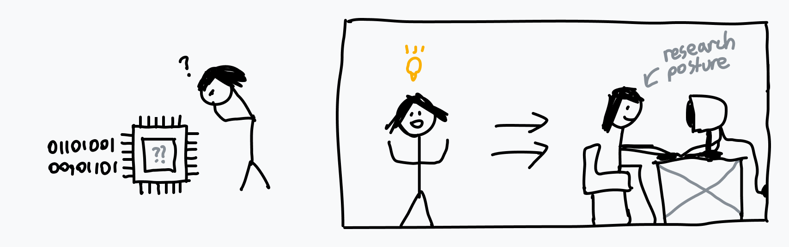

# 序章

我在计算机上[做过很多事情](https://github.com/kognise)，但我的知识里一直有个缺口：当你在电脑上运行一个程序时，究竟发生了什么？我反复琢磨这个缺口——大部分底层的必备知识我都有，却始终没办法把它们拼成完整的图景。程序真的直接在 CPU 上执行吗，还是背后另有玄机？我用过系统调用，可它们究竟是怎样*工作*的？系统调用到底是什么？多个程序又怎么能同时运行？

我终于绷不住了，开始尽可能多地把这些问题弄清楚。如果你不上大学，市面上并没有多少全面系统的学习资料，所以我不得不翻遍大量质量参差不齐、有时甚至互相矛盾的材料。几周的研究和将近 40 页笔记之后，我觉得自己总算更明白计算机从启动到执行程序的整个过程了。我当初愿意不惜一切代价，只为找到一篇靠谱的文章，把学到的东西一次讲清楚——所以现在，我要写出那篇我当初希望存在的文章。

俗话说得好……只有能讲给别人听，你才算真正理解了一件事。

> 赶时间？觉得自己早就懂这些了？
>
> [去读第 3 章](03-how-to-run-a-program.md)吧，我保证你还能学到新东西。除非你就是 Linus Torvalds 本人。

---

下一章：[第 1 章：所谓“基础”](01-the-basics.md)
