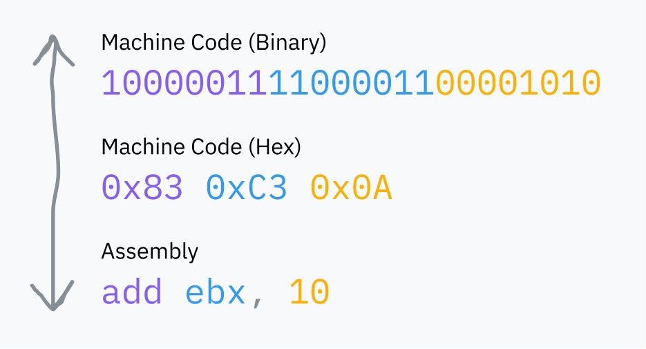
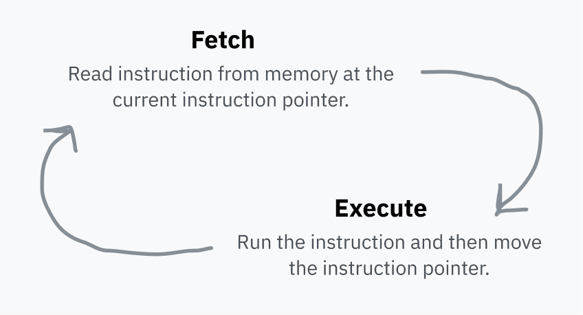
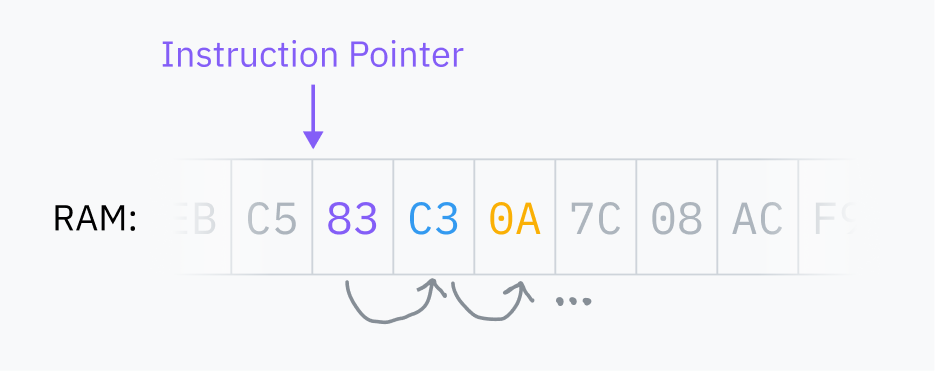
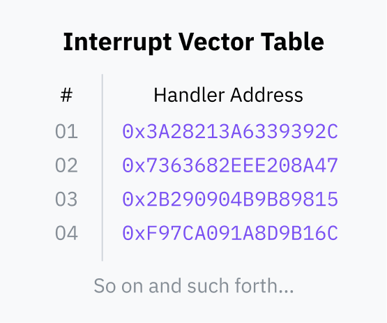
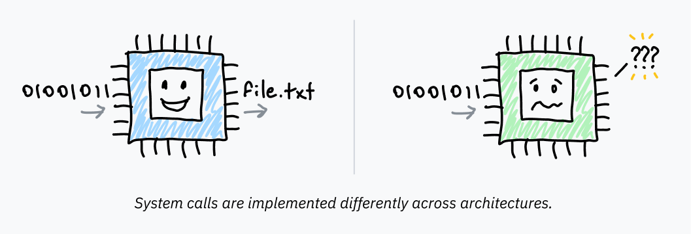

# 所谓“基础”

写这篇文章的过程中，一次又一次让我吃惊的是：计算机竟然这么*简单*。我还是很难不自己吓自己，总觉得事情会比实际存在的更复杂、更抽象！如果继续往下读之前只能牢记一件事，那就是：一切看起来简单的东西，真的就有那么简单。这种简单性非常优美，有时也极其、极其邪门。

让我们从最核心的地方开始，看看你的计算机是如何工作的。

## 计算机的架构是怎样的

计算机的*中央处理器*（central processing unit，CPU）负责所有计算。它是老大，是魔法里的那声“沙赞阿拉卡布拉”。你一开机，它就开始吭哧吭哧地运转，执行一条又一条指令。

第一款量产的 CPU 是 [Intel 4004](http://www.intel4004.com/)，由意大利物理学家兼工程师 Federico Faggin 在 60 年代末设计。它采用 4 位架构，而不是我们今天使用的 [64 位](https://en.wikipedia.org/wiki/64-bit_computing)系统；它远比现代处理器简单，但它的许多简单之处至今仍然保留着。

CPU 执行的“指令”就是二进制数据：用一两个字节表示要运行什么指令（操作码，opcode），后面跟着执行该指令所需的数据。我们所说的*机器码*（machine code），不过是一连串这样的二进制指令。[汇编语言](https://en.wikipedia.org/wiki/Assembly_language)（assembly）则是一种便于人类读写机器码的语法；它总是会被汇编成 CPU 能够读懂的二进制。

> 题外话：指令并不总像上面的例子那样与机器码一一对应。比如，`add eax, 512` 会被翻译成 `05 00 02 00 00`。
>
> 第一个字节（`05`）是一个操作码，专门表示*把 EAX 寄存器加上一个 32 位数*。剩下的字节是 512（`0x200`），采用[小端序](https://en.wikipedia.org/wiki/Endianness)（little-endian）排列。
>
> Defuse Security 做了一个[很好用的工具](https://defuse.ca/online-x86-assembler.htm)，可以拿来玩汇编与机器码之间的转换。

RAM 是计算机的主内存，是一块很大的多用途空间，存放着电脑上运行的程序所使用的全部数据，既包括程序代码本身，也包括操作系统核心的代码。CPU 总是直接从 RAM 读取机器码；如果代码没有被加载进 RAM，就无法运行。

CPU 保存着一个*指令指针*（instruction pointer），指向 RAM 中下一条要取出的指令所在的位置。每执行完一条指令，CPU 就移动这个指针，然后重复上述过程。这就是*取指—执行循环*（fetch-execute cycle）。

执行完一条指令后，指针会向前移动到 RAM 中紧跟在刚才那条指令后面的位置，于是它就指向了下一条指令。代码就是这样跑起来的！指令指针不断向前推进，按照机器码在内存中存储的顺序依次执行。有些指令可以让指令指针跳到别处，或者根据某个条件跳到不同的位置；这让可复用的代码和条件逻辑成为可能。

指令指针保存在一个[*寄存器*](https://en.wikipedia.org/wiki/Processor_register)（register）里。寄存器是极小的存储槽，CPU 读写它们的速度非常快。每种 CPU 架构都有一组固定的寄存器，用来保存计算过程中的临时值、配置处理器，等等。

有些寄存器可以直接从机器码访问，比如前面示意图里的 `ebx`。

另一些寄存器仅供 CPU 内部使用，但通常可以通过专用指令更新或读取。指令指针就是一个例子：它不能直接被读取，但可以通过跳转指令等方式更新。

## 处理器很天真

让我们回到最初的问题：当你在电脑上运行一个可执行程序时，会发生什么？首先会发生一堆魔法般的准备工作——这些我们后面都会讲到——但整个过程的终点，是某个文件里的机器码。操作系统把它加载进 RAM，并命令 CPU 把指令指针跳到 RAM 中的那个位置。CPU 照常继续它的取指—执行循环，于是程序开始运行了！

（这又是那种让我自己吓自己的时刻——说真的，你现在用来阅读这篇文章的程序就是这样跑起来的！你的 CPU 正按顺序从 RAM 中取出浏览器的指令并直接执行，于是它们渲染出了这篇文章。）

原来 CPU 的世界观超级简单：它只看得到当前的指令指针和一点内部状态。进程完全是操作系统层面的抽象，CPU 既不天生理解它，也不负责跟踪它。

*\*挥挥手\* 进程是 ~~操作系统开发者~~ 大字节公司为了卖出更多电脑而编造出来的抽象*

对我来说，这引出的问题比答案还多：

1. 如果 CPU 根本不知道多进程处理，只是按顺序执行指令，那它为什么不会卡在当前运行的程序里？多个程序怎么能同时运行？
2. 如果程序直接在 CPU 上运行，而 CPU 又能直接访问 RAM，为什么一段代码不能访问其他进程的内存？更别提内核的内存了，天哪。
3. 说到这个，究竟是什么机制阻止每个进程随意执行任何指令、对你电脑为所欲为？还有，系统调用到底是个什么鬼东西？

关于内存的问题值得单独用一节来讲，已放在[第 5 章](05-the-translator-in-your-computer.md)——简而言之（TL;DR），大多数内存访问其实会经过一层“障眼法”，把整个地址空间重新映射。现在，我们先假装程序可以直接访问所有 RAM，而计算机一次只能运行一个进程。这两个假设我们迟早都会解释清楚。

是时候跳进第一个兔子洞，进入一个满是系统调用和安全环的世界了。

> **题外话：内核到底是什么？**
>
> 你电脑上的操作系统，比如 macOS、Windows 或 Linux，是运行在电脑上、让所有基础功能正常运作的软件集合。“基础功能”是个很宽泛的说法，“操作系统”也是——取决于你问谁，它可能还包括电脑默认自带的应用程序、字体和图标。
>
> 不过，内核（kernel）是操作系统的核心。当你启动电脑时，指令指针会从某个程序开始执行。那个程序就是内核。内核几乎可以完全访问电脑的内存、外设和其他资源，并负责运行安装在电脑上的软件（也就是用户空间程序，userland programs）。随着文章推进，我们会了解内核如何拥有这些访问权限，以及用户空间程序为什么没有。
>
> Linux 只是一个内核，要变得可用还需要大量用户空间软件，比如 shell 和显示服务器。macOS 的内核叫 [XNU](https://en.wikipedia.org/wiki/XNU)，是类 Unix 内核；现代 Windows 的内核则叫 [NT 内核](https://en.wikipedia.org/wiki/Architecture_of_Windows_NT)。

## 双环定乾坤

处理器所处的*模式*（mode，有时也叫特权级或环）决定了它能做什么。现代架构至少提供两种选项：内核模式（kernel/supervisor mode）和用户模式（user mode）。虽然一种架构可能支持两种以上的模式，但如今常用的只有内核模式和用户模式。

在内核模式里，什么都放行：CPU 可以执行任何受支持的指令，访问任何内存。在用户模式里，只允许执行一部分指令，I/O 和内存访问受到限制，许多 CPU 设置也被锁住。一般来说，内核和驱动程序运行在内核模式，应用程序则运行在用户模式。

处理器启动时处于内核模式。在执行某个程序之前，内核会发起切换到用户模式的操作。

处理器模式在真实架构中如何体现？以 x86-64 为例，当前特权级（current privilege level，CPL）可以从一个叫 `cs`（代码段，code segment）的寄存器中读出。具体来说，CPL 位于 `cs` 寄存器的两个[最低有效位](https://en.wikipedia.org/wiki/Bit_numbering)。这两位可以表示 x86-64 的四种可能环：0 环是内核模式，3 环是用户模式。1 环和 2 环是为运行驱动程序设计的，但只有少数较老的小众操作系统用过。比如，如果 CPL 这两位是 `11`，CPU 就运行在 3 环：用户模式。

## 系统调用到底是个啥？

程序运行在用户模式，是因为不能信任它们拥有对计算机的完全访问权。用户模式确实管用，挡住了对计算机大部分资源的访问——但程序总得*有办法*访问 I/O、分配内存、与操作系统交互吧！为此，运行在用户模式的软件必须向操作系统内核求助。然后，操作系统可以实施自己的安全保护，防止程序做出恶意行为。

如果你写过与操作系统交互的代码，大概会认得 `open`、`read`、`fork` 和 `exit` 这些函数。剥开几层抽象之后，它们都在使用*系统调用*（system call）向操作系统求助。系统调用是一种特殊过程，让程序从用户空间切换到内核空间，从程序代码跳进操作系统代码。

从用户空间到内核空间的控制权转移，靠的是处理器的一项特性：[*软件中断*](https://en.wikipedia.org/wiki/Interrupt#Software_interrupts)（software interrupt）：

1. 在启动过程中，操作系统会在 RAM 中保存一张[*中断向量表*](https://en.wikipedia.org/wiki/Interrupt_vector_table)（interrupt vector table，IVT；x86-64 称之为[中断描述符表](https://en.wikipedia.org/wiki/Interrupt_descriptor_table)，interrupt descriptor table），并向 CPU 注册。IVT 把中断号映射到处理程序的代码指针。

   

2. 接下来，用户空间程序可以使用类似 [INT](https://www.felixcloutier.com/x86/intn:into:int3:int1) 的指令。这条指令告诉处理器：在 IVT 中查找给定的中断号，切换到内核模式，然后把指令指针跳转到 IVT 中保存的内存地址。

当这段内核代码执行完毕后，它会使用类似 [IRET](https://www.felixcloutier.com/x86/iret:iretd:iretq) 的指令，告诉 CPU 切回用户模式，并把指令指针返回到触发中断时所处的位置。

（如果你好奇的话，Linux 上用于系统调用的中断号是 `0x80`。你可以在 [Michael Kerrisk 的在线 manpage 目录](https://man7.org/linux/man-pages/man2/syscalls.2.html)里读到 Linux 系统调用列表。）

### 封装 API：把中断抽象掉

到目前为止，关于系统调用，我们知道这些：

- 用户模式程序不能直接访问 I/O 或内存。它们必须向操作系统求助，才能与外部世界交互。
- 程序可以通过 INT、IRET 这类特殊机器码指令，把控制权交给操作系统。
- 程序不能直接切换特权级；软件中断是安全的，因为处理器已被*操作系统*预先配置好该跳到操作系统代码的哪个位置。中断向量表只能在内核模式下配置。

程序在触发系统调用时需要把数据传给操作系统；操作系统需要知道该执行哪个具体的系统调用，以及该系统调用自身需要的数据，比如要打开哪个文件名。传递这些数据的机制因操作系统和架构而异，但通常是在触发中断之前，把数据放进特定寄存器或栈里。

系统调用的调用方式在不同平台上存在差异，这意味着让程序员在每个程序里亲自实现系统调用会极其不切实际。这也意味着操作系统不敢随便改动自己的中断处理方式，生怕弄坏每一个按旧方式编写的程序。最后，我们通常也不再直接用汇编写程序了——不能指望程序员每次想读个文件或分配点内存时都下降到汇编层。

于是，操作系统在这些中断之上提供了一层抽象。在类 Unix 系统上，[libc](https://www.gnu.org/software/libc/) 提供了可复用的高层库函数，把必要的汇编指令包装起来；在 Windows 上，这部分功能属于一个叫 [ntdll.dll](https://learn.microsoft.com/en-us/windows-hardware/drivers/kernel/libraries-and-headers) 的库。调用这些库函数本身不会切换到内核模式，它们只是普通的函数调用。在库的内部，汇编代码才真正把控制权交给内核，而且它比外层包装的库子程序要依赖平台得多。

当你在类 Unix 系统上从 C 代码调用 `exit(1)` 时，这个函数内部会先把系统调用的操作码和参数放进正确的寄存器、栈或其他地方，然后运行机器码触发中断。计算机真是太酷了！

## 对速度的渴求 / 整点 CISC 味

由于系统调用范式非常普遍，许多 [CISC](https://en.wikipedia.org/wiki/Complex_instruction_set_computer) 架构（比如 x86-64）都包含专为系统调用设计的指令。

Intel 和 AMD 在 x86-64 上没能很好地协调，所以它实际上有*两套*优化过的系统调用指令。[SYSCALL](https://www.felixcloutier.com/x86/syscall.html) 和 [SYSENTER](https://www.felixcloutier.com/x86/sysenter) 是 `INT 0x80` 这类指令的优化替代品。它们对应的返回指令 [SYSRET](https://www.felixcloutier.com/x86/sysret.html) 和 [SYSEXIT](https://www.felixcloutier.com/x86/sysexit)，则用于快速切回用户空间并恢复程序代码。

（AMD 和 Intel 处理器对这些指令的兼容性略有不同。对 64 位程序来说，`SYSCALL` 通常是最佳选择；而 `SYSENTER` 对 32 位程序的支持更好。）

作为这类设计的代表，[RISC](https://en.wikipedia.org/wiki/Reduced_instruction_set_computer) 架构往往没有这类特殊指令。Apple Silicon 所基于的 RISC 架构 AArch64，只使用[一条中断指令](https://developer.arm.com/documentation/ddi0596/2021-12/Base-Instructions/SVC--Supervisor-Call-)来同时处理系统调用和软件中断。我觉得 Mac 用户过得挺好的 :)

---

呼，内容真不少！我们来简短回顾一下：

- 处理器在一个无限的取指—执行循环中执行指令，根本没有操作系统或程序的概念。处理器的模式（通常保存在寄存器中）决定它可以执行哪些指令。操作系统代码运行在内核模式，并切换到用户模式来运行程序。
- 要运行一个二进制文件，操作系统会切换到用户模式，并让处理器指向代码在 RAM 中的入口点。由于只有用户模式的权限，想要与外部世界交互的程序必须跳到操作系统代码中求助。系统调用是程序从用户模式切换到内核模式、进入操作系统代码的一种标准化方式。
- 程序通常通过调用共享库函数来使用这些系统调用。这些库函数包装了软件中断或架构专用系统调用指令的机器码，从而把控制权交给操作系统内核并切换环。内核处理完事务后，再切回用户模式，返回程序代码。

现在，让我们回答前面提出的第一个问题：

> 如果 CPU 不跟踪一个以上的进程，只是一条接一条地执行指令，那它为什么不会卡在当前运行的程序里？多个程序怎么能同时运行？

亲爱的朋友，这个问题的答案，也是 Coldplay 为什么那么受欢迎的原因……是时钟！（好吧，严格来说是定时器。我只是硬把 Coldplay 的《Clocks》梗塞了进来。）

---

上一章：[序章](00-intro.md) · 下一章：[第 2 章：切分时间](02-slice-dat-time.md)
