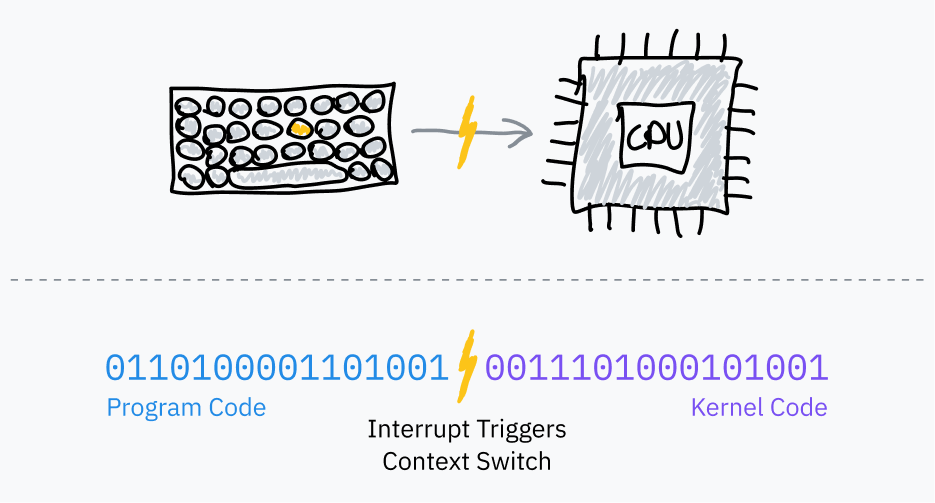
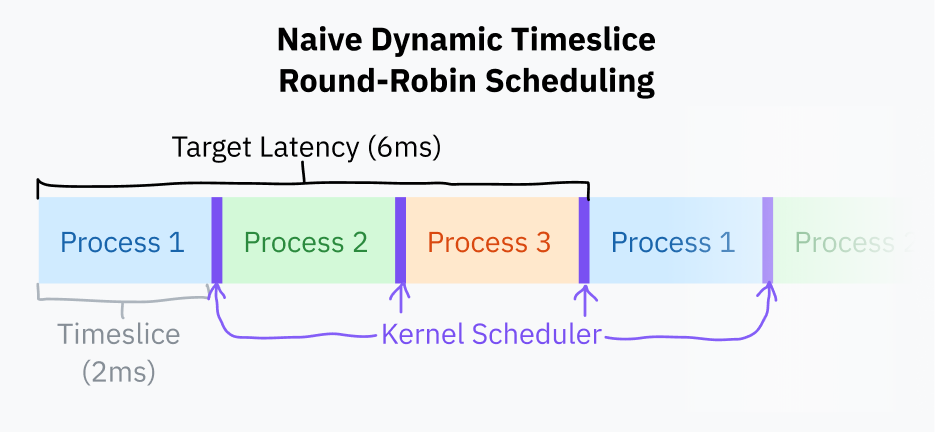

# 切分时间

假设你正在开发一个操作系统，希望用户能同时运行多个程序。但你没有花哨的多核处理器，所以你的 CPU 一次只能运行一条指令！

幸运的是，你是一位非常聪明的操作系统开发者。你发现可以让大家轮流使用 CPU，从而伪装出并行效果。只要在进程之间循环，每次运行每个进程的一小段指令，它们就都能保持响应，而不会有某个进程霸占整个 CPU。

但你要怎么从程序代码手里夺回控制权，以便切换进程呢？查了一些资料后，你发现大多数计算机都带有定时器芯片。你可以对定时器芯片编程，让它在经过一定时间后触发一次中断，切换到操作系统的中断处理程序。

## 硬件中断

前面我们讲过，软件中断用于把控制权从用户空间程序交给操作系统。它们之所以叫“软件”中断，是因为由程序自愿触发——处理器在正常的取指—执行循环中执行到机器码，然后按机器码的要求把控制权交给内核。

操作系统调度器使用 [PIT](https://en.wikipedia.org/wiki/Programmable_interval_timer)（可编程间隔定时器）之类的*定时器芯片*来触发硬件中断，从而实现多任务：

1. 在跳到程序代码之前，操作系统设置定时器芯片，让它在经过一段时间后触发中断。
2. 操作系统切换到用户模式，跳到程序的下一条指令。
3. 定时器到期时，它触发硬件中断，切换到内核模式并跳到操作系统代码。
4. 现在操作系统可以保存程序中断的位置，加载另一个程序，然后重复这个过程。

这叫作*抢占式多任务*（preemptive multitasking）；打断一个进程的行为叫作[*抢占*](https://en.wikipedia.org/wiki/Preemption_(computing))（preemption）。比如说，如果你一边用浏览器读这篇文章，一边在同一台机器上听音乐，你自己的电脑很可能每秒钟都在重复这个循环上千次。

## 时间片的计算

*时间片*（timeslice）是操作系统调度器允许一个进程运行多久再抢占它的时长。选择时间片最简单的方法，是给每个进程相同的时间片，比如 10 ms 左右，然后按顺序轮转任务。这叫作*固定时间片轮转*（fixed timeslice round-robin）调度。

> **题外话：有趣的术语小知识！**
>
> 你知道时间片经常被称为“量子”（quantum）吗？现在你知道了，可以去让所有技术圈朋友刮目相看。我觉得自己理应收获大量赞美，因为这篇文章没有每隔一句就说一次“量子”。
>
> 说到时间片术语，Linux 内核开发者使用 [jiffy](https://github.com/torvalds/linux/blob/22b8cc3e78f5448b4c5df00303817a9137cd663f/include/linux/jiffies.h) 这个时间单位来计数固定频率的定时器滴答。除了别的用途之外，jiffy 也用于衡量时间片的长度。Linux 的 jiffy 频率通常是 1000 Hz，但在编译内核时可以配置。

固定时间片调度的一个小改进，是选定一个*目标延迟*（target latency）——也就是进程做出响应的理想最长时间。目标延迟指的是在进程数量合理的前提下，一个进程被抢占后重新恢复执行所花的时间。*这有点难以想象！别担心，图很快就来。*

时间片的计算方式是：用目标延迟除以任务总数。这比固定时间片调度更好，因为当进程较少时，它避免了浪费性的任务切换。如果目标延迟是 15 ms，有 10 个进程，那么每个进程可以运行 15/10，也就是 1.5 ms。如果只有 3 个进程，每个进程就能得到更长的 5 ms 时间片，同时仍然满足目标延迟。

进程切换的计算开销很高，因为它需要保存当前程序的整个状态，再恢复另一个程序的状态。超过某个临界点后，时间片太小会导致进程切换过于频繁，从而引发性能问题。通常会给时间片时长设一个下界（*最小粒度*，minimum granularity）。这确实意味着，当进程多到足以触发最小粒度时，目标延迟就会被超过。

在撰写本文时，Linux 调度器使用的目标延迟是 6 ms，最小粒度是 0.75 ms。

用这种基本时间片计算方式做轮转调度，已经接近如今大多数计算机的做法。不过它还是有点天真；大多数操作系统倾向于使用更复杂的调度器，把进程优先级和截止时间考虑进去。自 2007 年起，Linux 使用一种名为[完全公平调度器](https://docs.kernel.org/scheduler/sched-design-CFS.html)（Completely Fair Scheduler，CFS）的调度器。CFS 做了许多非常花哨的计算机科学工作，来给任务排定优先级并分配 CPU 时间。

操作系统每次抢占一个进程时，都需要加载新程序保存的执行上下文，包括它的内存环境。这是通过让 CPU 使用另一张*页表*（page table）来实现的——页表负责把“虚拟”地址映射到物理地址。这也是防止程序访问彼此内存的机制；我们会在本文的[第 5 章](05-the-translator-in-your-computer.md)和[第 6 章](06-lets-talk-about-forks-and-cows.md)深入这个兔子洞。

## 注记 1：内核可抢占性

到目前为止，我们只讨论了用户空间进程的抢占和调度。如果内核代码花太长时间处理系统调用或执行驱动程序代码，程序就可能变得卡顿。

包括 Linux 在内的现代内核都是[可抢占内核](https://en.wikipedia.org/wiki/Kernel_preemption)（preemptive kernel）。这意味着它们的编写方式允许内核代码本身像用户空间进程一样被中断和调度。

除非你在写内核之类的东西，否则这一点并不太重要；但基本上我读过的每篇文章都提到过它，所以我觉得自己也该提一嘴！额外的知识很少是坏事。

## 注记 2：一段历史课

古老的操作系统，包括经典 Mac OS 和远早于 NT 的 Windows 版本，使用过抢占式多任务的前身。不是由操作系统决定何时抢占程序，而是程序自己选择向操作系统让出控制权。它们会触发软件中断，说：“嘿，现在可以让另一个程序运行了。”这些显式让出，是操作系统重新获得控制权并切换到下一个已排定的进程的唯一方式。

这叫作[*协作式多任务*](https://en.wikipedia.org/wiki/Cooperative_multitasking)（cooperative multitasking）。它有几个重大缺陷：恶意或设计糟糕的程序很容易冻住整个操作系统；而且几乎不可能保证实时/时间敏感任务的时序一致性。由于这些原因，科技界很久以前就转向了抢占式多任务，再也没回头。

---

上一章：[第 1 章：所谓“基础”](01-the-basics.md) · 下一章：[第 3 章：如何运行一个程序](03-how-to-run-a-program.md)
