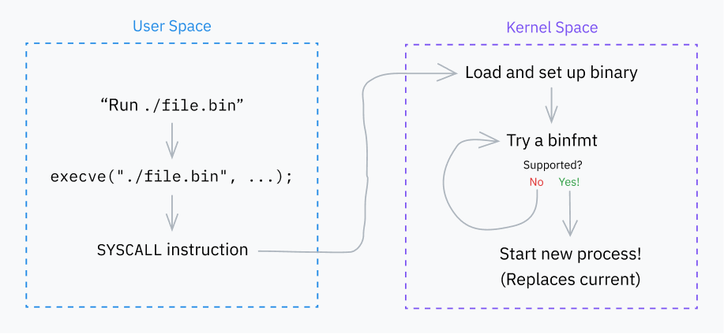
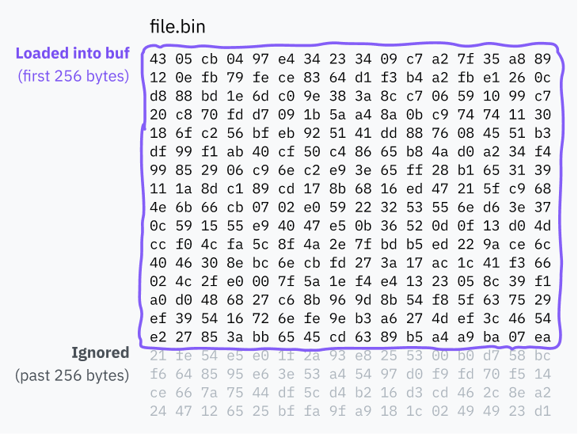

# 如何运行一个程序

到目前为止，我们已经讲了 CPU 如何执行从可执行文件加载的机器码、什么是基于环的安全机制，以及系统调用如何工作。这一节，我们会深入 Linux 内核，弄清楚程序最初是如何被加载和运行的。

我们会具体研究 x86-64 上的 Linux。为什么？

- Linux 是一个功能完整、可用于桌面、移动端和服务器场景的生产级操作系统。Linux 是开源的，所以只要读源码就很容易研究。我会在文章中直接引用一些内核代码！
- x86-64 是大多数现代台式机使用的架构，也是大量代码的目标架构。我提到的那些 x86-64 专属行为，在很大程度上也能推广到其他地方。

我们学到的大部分内容都能很好地推广到其他操作系统和架构，即使它们在各种具体细节上有所不同。

## Exec 系统调用的基本行为



我们先从一个非常重要的系统调用开始：`execve`。它加载一个程序，如果成功，就用该程序替换当前进程。另外还有几个系统调用（`execlp`、`execvpe` 等），但它们都以不同方式构建在 `execve` 之上。

> **题外话：`execveat`**
>
> `execve` *实际上*构建在 `execveat` 之上，后者是一个更通用的系统调用，可以带一些配置选项来运行程序。为简单起见，我们主要讨论 `execve`；两者的唯一区别是，`execve` 为 `execveat` 提供了一些默认值。
>
> 好奇 `ve` 代表什么吗？`v` 表示其中一个参数是参数*向量*（vector，即列表），也就是 `argv`；`e` 表示另一个参数是环境变量向量，也就是 `envp`。其他各种 exec 系统调用用不同后缀来区分不同的调用签名。`execveat` 里的 `at` 就是“at”，因为它指定了在哪个位置运行 `execve`。

`execve` 的调用签名是：

```c
int execve(const char *filename, char *const argv[], char *const envp[]);
```

- `filename` 参数指定要运行的程序路径。
- `argv` 是一个以空指针结尾（也就是说，最后一项是空指针）的参数列表。你经常看到传给 C 语言 `main` 函数的 `argc` 参数，其实是系统调用稍后计算出来的，所以才需要空指针结尾。
- `envp` 参数包含另一个以空指针结尾的列表，里面是作为应用上下文的环境变量。它们……按惯例是 `KEY=VALUE` 形式的键值对。*按惯例。* 我爱死计算机了。

有趣的是！你知道“程序的第一个参数是程序名”这个惯例吗？这*纯粹是惯例*，实际上并不是 `execve` 系统调用自己设置的！第一个参数就是调用者传给 `execve` 的 `argv` 第一项，哪怕它和程序名毫无关系。

有意思的是，`execve` 里确实有一些代码假设 `argv[0]` 是程序名。这个我们后面讲到解释型脚本语言时再说。

### 第 0 步：定义

我们已经知道系统调用如何工作，但还没见过真实的代码示例！让我们看看 Linux 内核源码，看 `execve` 在底层是如何定义的：

```c
SYSCALL_DEFINE3(execve,
		const char __user *, filename,
		const char __user *const __user *, argv,
		const char __user *const __user *, envp)
{
	return do_execve(getname(filename), argv, envp);
}
```

*`fs/exec.c` 第 2105–2111 行 · [源码](https://github.com/torvalds/linux/blob/22b8cc3e78f5448b4c5df00303817a9137cd663f/fs/exec.c#L2105-L2111)*

`SYSCALL_DEFINE3` 是一个宏，用来定义一个接收 3 个参数的系统调用代码。

> 我很好奇为什么[参数个数](https://en.wikipedia.org/wiki/Arity)（arity）要硬编码在宏名里；上网查了查，才知道这是为了修复[某个安全漏洞](https://nvd.nist.gov/vuln/detail/CVE-2009-0029)而采用的变通办法。

文件名参数被传给 `getname()` 函数，该函数把字符串从用户空间复制到内核空间，并做一些引用计数之类的工作。它返回一个 `filename` 结构体，定义在 `include/linux/fs.h` 中。这个结构体保存了指向用户空间原始字符串的指针，也保存了指向复制到内核空间的新值的指针：

```c
struct filename {
	const char		*name;	/* 指向实际字符串 */
	const __user char	*uptr;	/* 原始用户空间指针 */
	int			refcnt;
	struct audit_names	*aname;
	const char		iname[];
};
```

*`include/linux/fs.h` 第 2294–2300 行 · [源码](https://github.com/torvalds/linux/blob/22b8cc3e78f5448b4c5df00303817a9137cd663f/include/linux/fs.h#L2294-L2300)*

然后，`execve` 系统调用会调用 `do_execve()` 函数。后者再用一些默认值调用 `do_execveat_common()`。我前面提到的 `execveat` 系统调用也会调用 `do_execveat_common()`，但会传入更多用户提供的选项。

下面的代码片段中，我给出了 `do_execve` 和 `do_execveat` 两个函数的定义：

```c
static int do_execve(struct filename *filename,
	const char __user *const __user *__argv,
	const char __user *const __user *__envp)
{
	struct user_arg_ptr argv = { .ptr.native = __argv };
	struct user_arg_ptr envp = { .ptr.native = __envp };
	return do_execveat_common(AT_FDCWD, filename, argv, envp, 0);
}

static int do_execveat(int fd, struct filename *filename,
		const char __user *const __user *__argv,
		const char __user *const __user *__envp,
		int flags)
{
	struct user_arg_ptr argv = { .ptr.native = __argv };
	struct user_arg_ptr envp = { .ptr.native = __envp };

	return do_execveat_common(fd, filename, argv, envp, flags);
}
```

*`fs/exec.c` 第 2028–2046 行 · [源码](https://github.com/torvalds/linux/blob/22b8cc3e78f5448b4c5df00303817a9137cd663f/fs/exec.c#L2028-L2046)*

在 `execveat` 中，一个文件描述符（一种指向*某个资源*的 id）会被传给系统调用，再传给 `do_execveat_common`。它指定了相对于哪个目录来执行程序。

在 `execve` 中，文件描述符参数使用了一个特殊值 `AT_FDCWD`。这是 Linux 内核中的一个共享常量，告诉函数把路径名解释为相对于当前工作目录。接受文件描述符的函数通常会带有类似这样的手动检查：`if (fd == AT_FDCWD) { /* 特殊代码路径 */ }`。

### 第 1 步：准备工作

现在我们来到了 `do_execveat_common`，它是处理程序执行的核心函数。我们先暂时把目光从代码上移开，从更高的视角看看这个函数到底做了什么。

`do_execveat_common` 的第一项主要工作，是设置一个叫 `linux_binprm` 的结构体。我不会贴出[完整的结构体定义](https://github.com/torvalds/linux/blob/22b8cc3e78f5448b4c5df00303817a9137cd663f/include/linux/binfmts.h#L15-L65)，但有几个重要字段需要过一遍：

- 定义 `mm_struct` 和 `vm_area_struct` 这类数据结构，为新程序的虚拟内存管理做准备。
- 计算并保存 `argc` 和 `envc`，以便传给程序。
- `filename` 和 `interp` 分别保存程序文件名和它的解释器。二者一开始相等，但在某些情况下会改变：其中一种情况就是运行带有 [shebang](https://en.wikipedia.org/wiki/Shebang_(Unix)) 的解释型脚本。比如执行一个 Python 程序时，`filename` 指向源文件，而 `interp` 是 Python 解释器的路径。
- `buf` 是一个数组，里面装着待执行文件的前 256 个字节。它用于检测文件格式，以及读取脚本的 shebang。

（今天学到了：binprm 代表 **bin**ary **pr**og**r**a**m**，二进制程序。）

让我们再仔细看看这个 `buf` 缓冲区：

```c
	char buf[BINPRM_BUF_SIZE];
```

*`linux_binprm @ include/linux/binfmts.h` 第 64 行 · [源码](https://github.com/torvalds/linux/blob/22b8cc3e78f5448b4c5df00303817a9137cd663f/include/linux/binfmts.h#L64)*

如你所见，它的长度由常量 `BINPRM_BUF_SIZE` 定义。在代码库中搜索这个字符串，可以在 `include/uapi/linux/binfmts.h` 找到它的定义：

```c
/* sizeof(linux_binprm->buf) */
#define BINPRM_BUF_SIZE 256
```

*`include/uapi/linux/binfmts.h` 第 18–19 行 · [源码](https://github.com/torvalds/linux/blob/22b8cc3e78f5448b4c5df00303817a9137cd663f/include/uapi/linux/binfmts.h#L18-L19)*

所以，内核会把被执行文件开头的 256 个字节加载到这块内存缓冲区中。

> **题外话：UAPI 是什么？**
>
> 你可能注意到上面代码的路径中有 `/uapi/`。为什么长度不像 `linux_binprm` 结构体那样定义在 `include/linux/binfmts.h` 里呢？
>
> UAPI 代表“用户空间 API”（userspace API）。在这个例子里，这意味着有人决定缓冲区长度应该成为内核公开 API 的一部分。理论上，所有 UAPI 内容都会暴露给用户空间，而所有非 UAPI 内容都是内核代码私有的。
>
> 内核代码和用户空间代码最初混在一起，是一团乱麻。2012 年，UAPI 代码被[重构到单独的目录](https://lwn.net/Articles/507794/)，试图提高可维护性。

### 第 2 步：Binfmt

内核接下来的主要工作，是遍历一堆“binfmt”（二进制格式，binary format）处理程序。这些处理程序定义在 `fs/binfmt_elf.c`、`fs/binfmt_flat.c` 之类的文件中。[内核模块](https://wiki.archlinux.org/title/Kernel_module)也可以向这个池子里添加自己的 binfmt 处理程序。

每个处理程序都提供一个 `load_binary()` 函数，它接收一个 `linux_binprm` 结构体，并检查自己是否理解该程序的格式。

这通常包括在缓冲区里寻找[魔数](https://en.wikipedia.org/wiki/Magic_number_(programming)#Format_indicator)（magic number）、尝试解码程序开头（同样来自缓冲区），以及/或者检查文件扩展名。如果处理程序支持这种格式，它就为执行程序做好准备并返回成功码；否则，就提前退出并返回错误码。

内核会依次尝试每个 binfmt 的 `load_binary()` 函数，直到遇到一个成功的为止。有时这些处理会递归进行；例如，如果一个脚本指定了解释器，而那个解释器本身又是一个脚本，那么层级可能是 `binfmt_script` > `binfmt_script` > `binfmt_elf`（ELF 是链条末端的可执行文件格式）。

### 格式聚焦：脚本

在 Linux 支持的众多格式中，`binfmt_script` 是我第一个想专门聊的。

你读过或写过 [shebang](https://en.wikipedia.org/wiki/Shebang_(Unix)) 吗？就是某些脚本开头那行指定解释器路径的内容？

```bash
#!/bin/bash
```

我一直以为这些是由 shell 处理的，但并不是！shebang 实际上是内核的功能，脚本和其他所有程序一样，是通过同样的系统调用执行的。计算机*真是太酷了*。

来看看 `fs/binfmt_script.c` 如何检查一个文件是否以 shebang 开头：

```c
	/* 如果不是以 "#!" 开头，那就不是我们要执行的。 */
	if ((bprm->buf[0] != '#') || (bprm->buf[1] != '!'))
		return -ENOEXEC;
```

*`load_script @ fs/binfmt_script.c` 第 40–42 行 · [源码](https://github.com/torvalds/linux/blob/22b8cc3e78f5448b4c5df00303817a9137cd663f/fs/binfmt_script.c#L40-L42)*

如果文件确实以 shebang 开头，binfmt 处理程序就会读取解释器路径，以及路径后面用空格分隔的参数。当遇到换行符或缓冲区末尾时，它就停下来。

这里有两件有趣又古怪的事。

**第一**，还记得 `linux_binprm` 里那个装着文件前 256 个字节的缓冲区吗？它既用于检测可执行文件格式，也正是 `binfmt_script` 读取 shebang 的地方。

我做研究时，读到过一篇文章说这个缓冲区长 128 字节。在那篇文章发表后的某个时间点，长度被加倍到了 256 字节！我很好奇为什么，于是查看了 `BINPRM_BUF_SIZE` 定义所在行的 Git blame——也就是记录某行代码被谁编辑过的日志。你瞧……

![一张 Visual Studio Code 编辑器中 Git blame 窗口的截图。Git blame 显示“#define BINPRM_BUF_SIZE 128”这一行被改成了 256。提交者是 Oleg Nesterov，主要说明文字是：“exec: increase BINPRM_BUF_SIZE to 256. Large enterprise clients often run applications out of networked file systems where the IT mandated layout of project volumes can end up leading to paths that are longer than 128 characters. Bumping this up to the next order of two solves this problem in all but the most egregious case while still fitting into a 512b slab.” 该提交由 Linus Torvalds 等人签署。](images/binprm-buf-changelog.png)

计算机真是太酷了！

因为 shebang 由内核处理，而且是从 `buf` 里读出来的，不会加载整个文件，所以它*总是*会被截断到 `buf` 的长度。显然，4 年前，有人因为内核会截断自己超过 128 个字符的路径而烦恼，而他们的解决办法居然是让缓冲区大小翻倍，从而把截断点也翻倍！今天，在你自己的 Linux 机器上，如果你的 shebang 行超过 256 个字符，那么第 256 个字符之后的内容都会*彻底消失*。



想象一下，因为这个原因遇到一个 bug。想象一下，你试图弄清楚代码到底为什么坏掉。想象一下，当你发现问题的根源深埋在 Linux 内核里时，会是什么感受。下一位在大型企业工作的 IT 人员，如果发现某条路径的一部分神秘失踪，可就要倒霉了。

**第二件古怪的事：**还记得吗，`argv[0]` 是程序名这一点*只是惯例*，调用者可以给 exec 系统调用传任何 `argv`，而它会原封不动地传递下去？

偏偏 `binfmt_script` 就是那种*假设* `argv[0]` 是程序名的代码。它总是会移除 `argv[0]`，然后把下面这些内容加到 `argv` 开头：

- 解释器路径
- 传给解释器的参数
- 脚本的文件名

> **例子：参数修改**
>
> 假设有这样一次 `execve` 调用：
>
> ```c
> // 参数：filename、argv、envp
> execve("./script", [ "A", "B", "C" ], []);
> ```
>
> 假设这个假想的 `script` 文件第一行是这样的 shebang：
>
> ```js
> #!/usr/bin/node --experimental-module
> ```
>
> 最终传给 Node 解释器的修改后 `argv` 会是：
>
> ```c
> [ "/usr/bin/node", "--experimental-module", "./script", "B", "C" ]
> ```

更新 `argv` 之后，这个处理程序会通过把 `linux_binprm.interp` 设置为解释器路径（在这个例子里是 Node 二进制文件），完成文件的执行准备工作。最后，它返回 0，表示已经成功为执行做好了准备。

### 格式聚焦：其他解释器

另一个有意思的处理程序是 `binfmt_misc`。它允许用户空间通过配置添加一些有限的格式：只要在 `/proc/sys/fs/binfmt_misc/` 挂载一个特殊文件系统，程序就可以向这个目录中的文件执行[特定格式](https://docs.kernel.org/admin-guide/binfmt-misc.html)的写入，从而添加自己的处理程序。每个配置项会指定：

- 如何检测它的文件格式。可以指定某个偏移处的魔数，也可以指定要查找的文件扩展名。
- 解释器可执行文件的路径。这里没有办法指定解释器参数，所以如果需要参数，就得写一个包装脚本。
- 一些配置标志，其中包括指定 `binfmt_misc` 如何更新 `argv` 的标志。

这个 `binfmt_misc` 系统经常被 Java 安装程序使用，用来根据 `0xCAFEBABE` 魔数识别 class 文件，并根据扩展名识别 JAR 文件。在我的系统上，还配置了一个处理程序，根据 .pyc 扩展名识别 Python 字节码，并把它交给相应的处理程序。

这是一种很酷的方式，让程序安装器无需编写高权限的内核代码，就能为自己的格式添加支持。

## 最后（不是 Linkin Park 那首歌）

一次 exec 系统调用最终总会走到两条路径之一：

- 它最终会遇到一种自己理解的可执行二进制格式——也许中间经过了好几层脚本解释器——然后运行那段代码。此时，旧代码已经被替换。
- ……或者，它耗尽所有选项，夹着尾巴向调用它的程序返回一个错误码。

如果你用过类 Unix 系统，可能注意到：从终端运行的 shell 脚本，即使没有 shebang 行或 `.sh` 扩展名，也照样能执行。如果你手边有非 Windows 终端，现在就可以试试：

```console
$ echo "echo hello" > ./file
$ chmod +x ./file
$ ./file
hello
```

（`chmod +x` 告诉操作系统这个文件是可执行的。否则你是没法运行它的。）

那么，为什么这个 shell 脚本能作为 shell 脚本运行？内核的格式处理程序应该没有办法在没有明显标记的情况下识别 shell 脚本啊！

嗯，事实证明，这种行为不是内核的一部分。它实际上是*你的 shell* 处理失败情况的一种常见方式。

当你通过 shell 执行一个文件，而 exec 系统调用失败时，大多数 shell 会*把文件当作 shell 脚本来重试执行*：也就是启动一个 shell，并把文件名作为第一个参数。Bash 通常会用它自己作为解释器，而 ZSH 会使用 `sh` 对应的程序，通常是 [Bourne shell](https://en.wikipedia.org/wiki/Bourne_shell)。

这种行为如此普遍，是因为它写进了[*POSIX*](https://en.wikipedia.org/wiki/POSIX) 规范。POSIX 是一个古老的标准，旨在让代码能在不同 Unix 系统之间移植。虽然大多数工具或操作系统并不严格遵循 POSIX，但它的许多惯例仍然被共同沿用。

> 如果 [exec 系统调用] 失败，且错误等同于 `[ENOEXEC]`，**shell 应执行一条命令，等价于用命令名作为第一个操作数调用一个 shell**，并把其余参数传给新 shell。如果可执行文件不是文本文件，shell 可以跳过这次命令执行。此时，它应写出错误消息，并返回退出状态 126。
>
> *来源：[Shell 命令语言，POSIX.1-2017](https://pubs.opengroup.org/onlinepubs/9699919799.2018edition/utilities/V3_chap02.html#tag_18_09_01_01)*

计算机真是太酷了！

---

上一章：[第 2 章：切分时间](02-slice-dat-time.md) · 下一章：[第 4 章：成为精灵领主](04-becoming-an-elf-lord.md)
