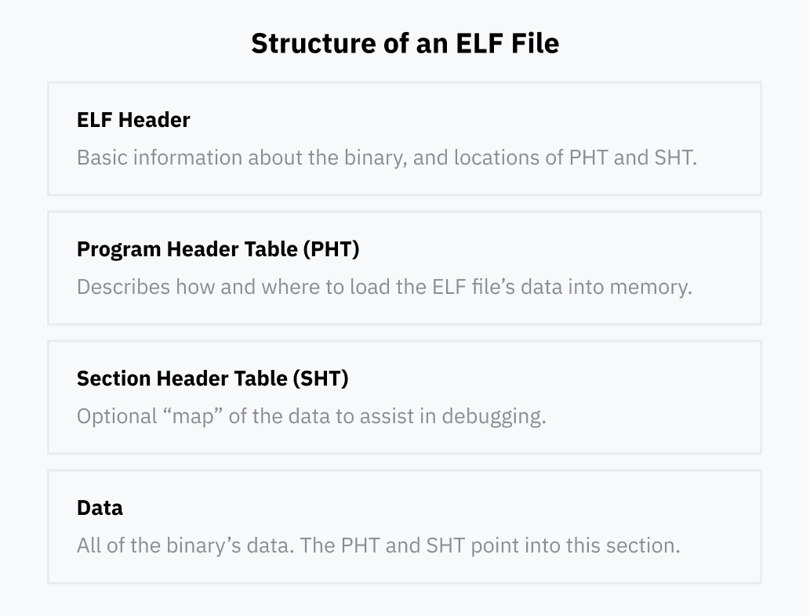
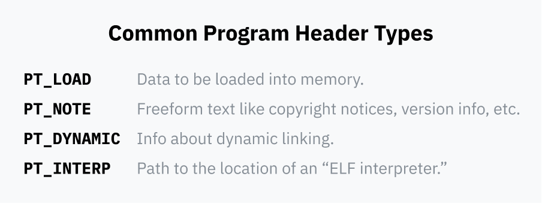
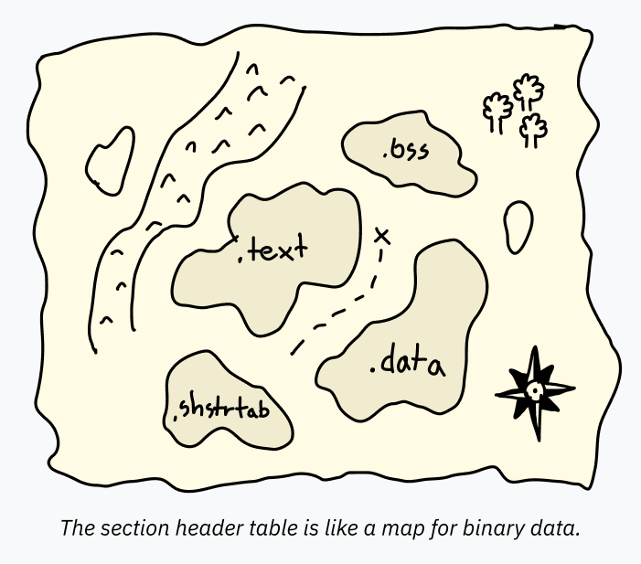
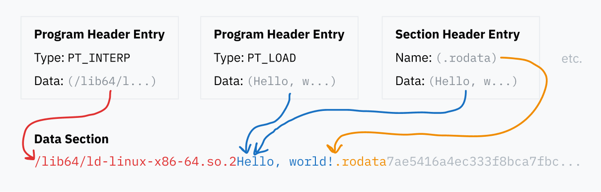
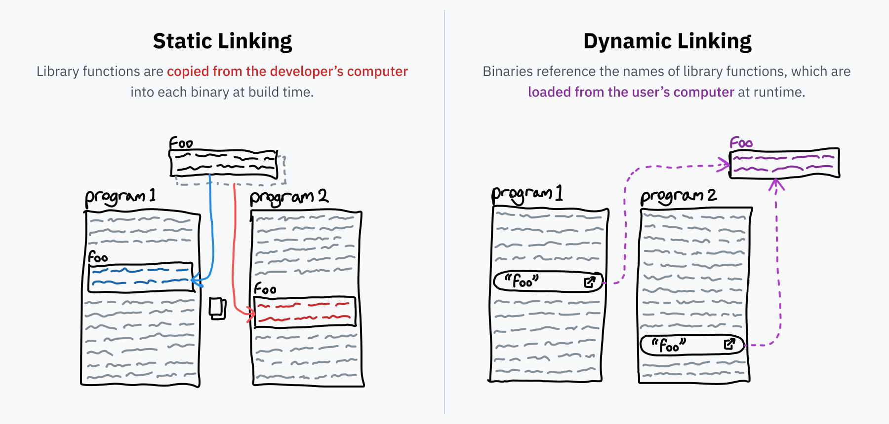

# 成为精灵领主

现在，我们已经相当透彻地理解了 `execve`。在大多数路径的终点，内核会到达一个最终程序，里面包含着要启动的机器码。通常，在真正跳到代码之前还需要一个设置过程——比如，程序的不同部分必须被加载到内存中正确的位置。每个程序对不同东西需要的内存量不同，所以我们有标准的文件格式，用来规定如何把程序设置好以便执行。虽然 Linux 支持许多这类格式，但迄今为止最常见的是 *ELF*（executable and linkable format，可执行与可链接格式）。


*（感谢 [Nicky Case](https://ncase.me/) 画出这么可爱的作品。）*

> **题外话：精灵无处不在吗？**
>
> 当你在 Linux 上运行一个应用或命令行程序时，它极有可能是一个 ELF 二进制文件。不过，在 macOS 上，事实上的格式是 [Mach-O](https://en.wikipedia.org/wiki/Mach-O)。Mach-O 完成的事情和 ELF 相同，只是结构不一样。在 Windows 上，.exe 文件使用[可移植可执行](https://en.wikipedia.org/wiki/Portable_Executable)（Portable Executable）格式，这又是另一种格式，但概念相同。

在 Linux 内核中，ELF 二进制文件由 `binfmt_elf` 处理程序负责，它比许多其他处理程序都复杂，包含数千行代码。它负责从 ELF 文件中解析出某些细节，并利用这些细节把进程加载到内存中并执行。

*我用了一些命令行功夫，把 binfmt 处理程序按行数排序：*

```console
$ wc -l binfmt_* | sort -nr | sed 1d
    2181 binfmt_elf.c
    1658 binfmt_elf_fdpic.c
     944 binfmt_flat.c
     836 binfmt_misc.c
     158 binfmt_script.c
      64 binfmt_elf_test.c
```

## 文件结构

在更深入地研究 `binfmt_elf` 如何执行 ELF 文件之前，我们先看看这种文件格式本身。ELF 文件通常由四部分组成：



### ELF 头

每个 ELF 文件都有一个 [ELF 头](https://refspecs.linuxfoundation.org/elf/gabi4+/ch4.eheader.html)。它的职责非常重要：传达关于二进制文件的基本信息，例如：

- 它面向哪种处理器。ELF 文件可以包含 ARM、x86 等不同处理器类型的机器码。
- 这个二进制文件是要独立作为可执行文件运行，还是要作为“动态链接库”被其他程序加载。我们很快就会详细介绍动态链接是什么。
- 可执行文件的入口点。后面的部分会精确指定 ELF 文件中的数据要加载到内存的什么位置。入口点是一个内存地址，指向整个进程加载完成后，第一条机器码指令所在的位置。

ELF 头总是在文件开头。它指定程序头表和节头表的位置，而这两张表可以在文件中的任何地方。反过来，这些表又指向存储在文件其他位置的数据。

### 程序头表

[程序头表](https://refspecs.linuxbase.org/elf/gabi4+/ch5.pheader.html)（program header table）是一系列条目，包含在运行时如何加载和执行二进制文件的具体细节。每个条目都有一个类型字段，说明它描述的是什么细节——例如，`PT_LOAD` 表示它包含应该加载到内存中的数据，而 `PT_NOTE` 表示这一段包含信息性文本，不一定需要加载到任何地方。



每个条目都会说明其数据在文件中的位置，有时还会说明如何把数据加载到内存：

- 它指向自己的数据在 ELF 文件中的位置。
- 它可以指定数据应该被加载到哪个虚拟内存地址。如果这一段不打算加载到内存中，这个字段通常留空。
- 有两个字段指定数据长度：一个表示数据在文件中的长度，另一个表示要创建的内存区域长度。如果内存区域比文件中的数据长，多出来的内存会用零填充。这对那些在运行时想要一块静态内存区域的程序很有用；这种空的内存段通常叫作 [BSS](https://en.wikipedia.org/wiki/.bss) 段。
- 最后，一个标志字段指定如果加载到内存，允许对它执行哪些操作：`PF_R` 表示可读，`PF_W` 表示可写，`PF_X` 表示这是代码，允许在 CPU 上执行。

### 节头表

[节头表](https://refspecs.linuxbase.org/elf/gabi4+/ch4.sheader.html)（section header table）是一系列条目，包含关于*节*（section）的信息。这些节信息就像一张地图，标出 ELF 文件内部的数据。它让[调试器之类的程序](https://www.sourceware.org/gdb/)能够轻松理解不同数据部分的用途。



举个例子，程序头表可以指定一大片数据一起加载到内存中。那个单独的 `PT_LOAD` 块可能同时包含代码和全局变量！为了*运行*程序，完全没有必要把它们分开指定；CPU 只是从入口点开始，一步步向前走，在程序请求的时间和位置访问数据。但是，像调试器这样用于*分析*程序的软件，需要知道每个区域的精确起止位置，否则它可能会把一段写着 “hello” 的文本当作代码来解码（而这并不是合法代码，于是——砰，炸了）。这类信息就存储在节头表里。

虽然通常会包含节头表，但它实际上是可选的。即使把节头表完全删掉，ELF 文件也能正常运行；有些想隐藏代码行为的开发者，会故意从自己的 ELF 二进制文件中剥离或篡改节头表，[让文件更难被解析](https://binaryresearch.github.io/2019/09/17/Analyzing-ELF-Binaries-with-Malformed-Headers-Part-1-Emulating-Tiny-Programs.html)。

每个节都有一个名字、一个类型，以及一些指定它应如何被使用和解码的标志。按照惯例，标准名称通常以点开头。最常见的节有：

- `.text`：要加载到内存并在 CPU 上执行的机器码。类型是 `SHT_PROGBITS`，带有 `SHF_EXECINSTR` 标志，表示可执行；还有 `SHF_ALLOC` 标志，表示它会被加载到内存中执行。（别被名字搞混了，它仍然只是二进制机器码！我一直觉得它明明不是可读的“文本”，却叫 `.text`，有点奇怪。）
- `.data`：硬编码在可执行文件中、要加载到内存的已初始化数据。比如，一个包含某些文本的全局变量可能就在这个节里。如果你写底层代码，静态变量（statics）就放在这里。它的类型同样是 `SHT_PROGBITS`，只表示这个节包含“供程序使用的信息”。它的标志是 `SHF_ALLOC` 和 `SHF_WRITE`，表示它是可写内存。
- `.bss`：我前面提过，程序经常会需要一些初始值为零的已分配内存。如果在 ELF 文件里塞一堆空字节，那就太浪费了，所以有一种特殊的段类型叫 BSS。调试时了解 BSS 段会很有帮助，因此节头表里也有一个条目指定要分配的内存长度。它的类型是 `SHT_NOBITS`，标志为 `SHF_ALLOC` 和 `SHF_WRITE`。
- `.rodata`：它和 `.data` 类似，但是只读。在一个运行 `printf("Hello, world!")` 的简单 C 程序里，字符串 “Hello, world!” 会放在 `.rodata` 节，而真正执行打印的代码会在 `.text` 节。
- `.shstrtab`：这是一个有趣的实现细节！节本身的名字（比如 `.text` 和 `.shstrtab`）并不直接包含在节头表里。相反，每个条目里保存的是一个偏移量，指向 ELF 文件中存放该名字的位置。这样一来，节头表里的每个条目都能保持相同大小，更容易解析——指向名字的偏移量是固定大小的数字，而如果把名字直接放进表里，就会变成变长字符串。所有名字数据都存储在它自己的节 `.shstrtab` 里，类型为 `SHT_STRTAB`。

### 数据

程序头表和节头表的条目都指向 ELF 文件中的数据块，无论是为了加载到内存、指定程序代码在哪里，还是仅仅为了给节命名。所有这些不同的数据片段，都包含在 ELF 文件的数据区中。



## 简说链接

回到 `binfmt_elf` 的代码：内核只关心程序头表中的两种条目。

`PT_LOAD` 段指定所有程序数据（比如 `.text` 和 `.data` 节）需要加载到内存中的哪里。内核从 ELF 文件中读取这些条目，把数据加载到内存，这样 CPU 就能执行程序。

内核关心的另一种程序头表条目是 `PT_INTERP`，它指定一个“动态链接运行时”。

在谈论动态链接是什么之前，我们先聊聊“链接”本身。程序员往往会在可复用代码库的基础上构建程序——例如前面提过的 libc。把源代码变成可执行二进制文件时，一个叫链接器（linker）的程序会通过找到库代码并把它复制进二进制文件，来解析所有这些引用。这个过程叫作*静态链接*（static linking），意味着外部代码被直接包含在分发的文件里。

然而，有些库实在太常用了。你会发现，几乎太阳底下的每个程序都在用 libc，因为它是通过系统调用与操作系统交互的标准接口。如果电脑上的每个程序都各自包含一份 libc 副本，那就太浪费空间了。而且，如果库里的 bug 能在一个地方修好，而不必等着每个使用该库的程序都更新，那该多好。动态链接就是这些问题的解决方案。

如果一个静态链接的程序需要名为 `bar` 的库中的函数 `foo`，那么这个程序会包含 `foo` 的完整副本。但如果它是动态链接的，程序里就只会包含一个引用，表示“我需要 `bar` 库里的 `foo`”。程序运行时，`bar` 最好已经安装在电脑上，然后 `foo` 函数的机器码可以按需加载到内存。如果电脑上安装的 `bar` 库更新了，那么程序下次运行时就会加载新代码，而程序本身不需要任何改动。



## 现实中的动态链接

在 Linux 上，像 `bar` 这样的动态可链接库通常打包成 .so（Shared Object，共享对象）扩展名的文件。这些 .so 文件和程序一样，也是 ELF 文件——你可能还记得，ELF 头里有一个字段用来指定文件是可执行文件还是库。此外，共享对象的节头表里还有一个 `.dynsym` 节，包含文件中导出了哪些符号、可以被动态链接的信息。

在 Windows 上，像 `bar` 这样的库会打包成 .dll（**d**ynamic **l**ink **l**ibrary，动态链接库）文件。macOS 使用 .dylib（**dy**namically linked **lib**rary）扩展名。就像 macOS 应用和 Windows .exe 文件一样，它们的格式和 ELF 略有不同，但概念和技术是相同的。

两种链接方式之间有一个有趣的差别：使用静态链接时，只有库中被用到的部分才会被包含进可执行文件，从而被加载到内存；而使用动态链接时，*整个库*都会被加载到内存。乍一听，这似乎效率更低，但实际上它让现代操作系统节省了*更多*空间：一个库只需加载到内存一次，然后就能在各个进程之间共享这段代码。只有代码可以共享，因为库在不同的程序中需要不同的状态，但节省的内存量仍然可以达到几十到几百兆字节。

## 执行

让我们跳回内核运行 ELF 文件的过程：如果它要执行的二进制文件是动态链接的，操作系统就不能立刻跳到二进制文件的代码，因为代码会不完整——记住，动态链接程序只有它需要的库函数的引用！

要运行这个二进制文件，操作系统需要弄清楚需要哪些库、加载它们、把所有按名字记录的指针替换成真正的跳转指令，*然后*才开始执行实际的程序代码。这是一段非常复杂的代码，与 ELF 格式深度交互，所以它通常是一个独立程序，而不是内核的一部分。ELF 文件在程序头表的 `PT_INTERP` 条目中，指定它想使用的程序路径（通常是 `/lib64/ld-linux-x86-64.so.2` 之类）。

读完 ELF 头并扫描程序头表之后，内核就可以为新程序建立内存结构。它先把所有 `PT_LOAD` 段加载到内存中，填好程序的静态数据、BSS 空间和机器码。如果程序是动态链接的，内核还需要执行 [ELF 解释器](https://unix.stackexchange.com/questions/400621/what-is-lib64-ld-linux-x86-64-so-2-and-why-can-it-be-used-to-execute-file)（`PT_INTERP`），所以它也会把解释器的数据、BSS 和代码加载到内存中。

现在，内核需要设置好 CPU 的指令指针，以便返回用户空间时恢复执行。如果可执行文件是动态链接的，内核就把指令指针设为 ELF 解释器代码在内存中的起始位置；否则，就设为可执行文件的起始位置。

内核几乎已经准备好从系统调用返回了（记住，我们还在 `execve` 里面）。它把 `argc`、`argv` 和环境变量压到栈上，供程序启动时读取。

现在，寄存器被清零了。在处理系统调用之前，内核会把当前的寄存器值保存到栈上，以便切回用户空间时恢复。在返回用户空间之前，内核会把栈上的这部分内容清零。

最后，系统调用结束，内核返回用户空间。它恢复寄存器（此时已经是零），然后跳到保存的指令指针。那个指令指针现在是新程序（或者 ELF 解释器）的起点，而当前进程已经被替换了！

---

上一章：[第 3 章：如何运行一个程序](03-how-to-run-a-program.md) · 下一章：[第 5 章：你电脑里的翻译官](05-the-translator-in-your-computer.md)
