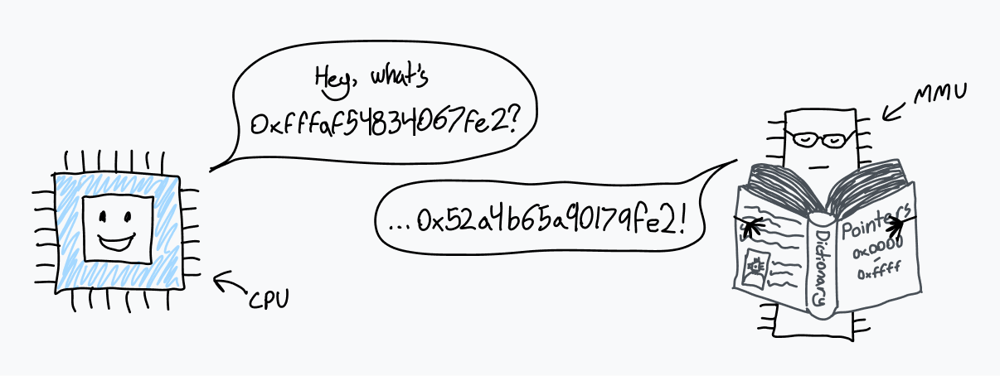
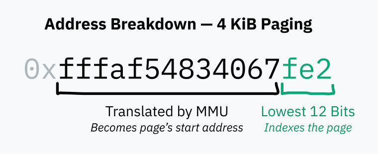
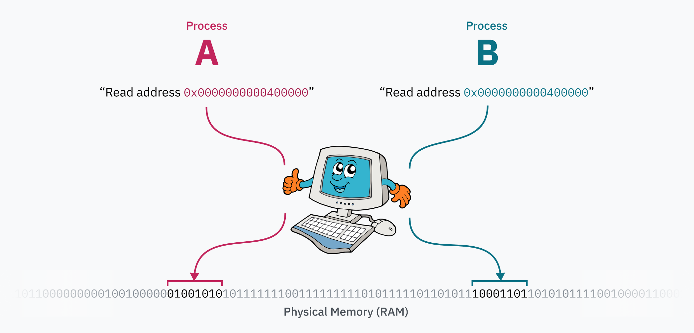
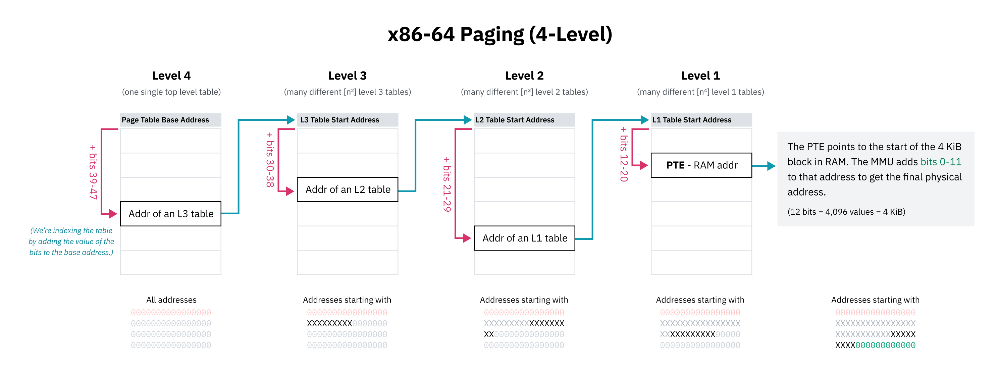

# 你电脑里的翻译官

到目前为止，我每次谈到读写内存时，说法都有点含糊。比如，ELF 文件指定了要把数据加载到哪些具体的内存地址，那为什么不会出现不同进程想使用冲突内存的问题？为什么每个进程似乎都有各自不同的内存环境？

还有，我们究竟是怎么走到这一步的？我们知道 `execve` 是一个用新程序*替换*当前进程的系统调用，但这并没有解释多个进程如何启动。它更没有解释第一个程序是怎么运行的——究竟哪只鸡（进程）下了所有其他蛋（其他进程）？

我们的旅程接近尾声了。等这两个问题回答完，对于你的电脑如何从开机走到运行你此刻正在使用的软件，我们就会有一个大致完整的理解。

## 内存是假的

那么……关于内存。事实证明，当 CPU 从某个内存地址读取或写入时，它实际上并不是在访问*物理*内存（RAM）中的那个位置，而是在指向*虚拟*内存空间中的一个位置。

CPU 与一个叫作[*内存管理单元*](https://en.wikipedia.org/wiki/Memory_management_unit)（memory management unit，MMU）的芯片通信。MMU 就像一个翻译官，手里有一本把虚拟内存位置翻译成 RAM 位置的词典。当 CPU 收到一条指令，要从内存地址 `0xfffaf54834067fe2` 读取数据时，它会请 MMU 翻译这个地址。MMU 在词典里查找，发现对应的物理地址是 `0x53a4b64a90179fe2`，然后把这个数字送回 CPU。接着，CPU 就可以从 RAM 中的那个地址读取数据了。



计算机刚启动时，内存访问会直接落到物理 RAM。启动之后不久，操作系统就会创建这本翻译词典，并告诉 CPU 开始使用 MMU。

这本词典实际上叫作*页表*（page table），而这种翻译每一次内存访问的机制叫作*分页*（paging）。页表中的条目叫作*页*（page），每一条表示某一块虚拟内存如何映射到 RAM。这些块的大小总是固定的，每种处理器架构的页大小不同。x86-64 默认页大小是 4 KiB，也就是说，每一页规定了长度为 4,096 字节的内存块如何映射。

换句话说，使用 4 KiB 页时，地址的低 12 位在 MMU 翻译前后总是保持不变——之所以是 12 位，是因为需要用这么多位来寻址翻译后得到的 4,096 字节页面内的每一个字节。

x86-64 还允许操作系统启用更大的 2 MiB 或 4 GiB 页。这可以提高地址翻译速度，但会增加内存碎片和浪费。页越大，MMU 负责翻译的那部分地址就越小。



页表本身就在 RAM 里。虽然它可能包含数百万个条目，但每个条目的大小只有几个字节，所以页表占用的空间并不算太大。

要在启动时启用分页，内核首先在 RAM 中构建页表。然后，它把页表起始位置的物理地址存入一个叫页表基址寄存器（page table base register，PTBR）的寄存器。最后，内核启用分页，让 MMU 翻译所有内存访问。在 x86-64 上，控制寄存器 3（CR3）的高 20 位充当 PTBR；控制寄存器 0（CR0）的第 31 位被指定为 PG（表示 Paging，分页），设为 1 即可启用分页。

分页系统的魔力在于，页表可以在计算机运行期间被修改。这就是每个进程都能拥有独立内存空间的原因——当操作系统从一个进程切换到另一个进程时，一项重要工作就是把虚拟内存空间重新映射到物理内存中的不同区域。假设你有两个进程：进程 A 可以把代码和数据（很可能是从 ELF 文件加载的！）放在 `0x0000000000400000`，进程 B 也可以从完全相同的地址访问自己的代码和数据。这两个进程甚至可以是同一个程序的两个实例，因为它们实际上并没有在争抢那段地址范围！进程 A 的数据位于物理内存中离进程 B 很远的地方，内核在切换到该进程时，会把它映射到 `0x0000000000400000`。



> **题外话：一个邪门的 ELF 事实**
>
> 在某些情况下，`binfmt_elf` 必须把内存的第 0 页映射到一块全零的内存。一些为 UNIX System V Release 4.0（SVr4）编写的程序依赖空指针可读——SVr4 是 1988 年的操作系统，也是第一个支持 ELF 的系统。不知怎么的，至今仍有一些程序依赖这种行为。
>
> 实现这一点的 Linux 内核开发者似乎[有点不满](https://github.com/torvalds/linux/blob/22b8cc3e78f5448b4c5df00303817a9137cd663f/fs/binfmt_elf.c#L1322-L1329)：
>
> *“你问为什么要这样？？？好吧，SVr4 把第 0 页映射为只读，而有些应用‘依赖’这种行为。既然我们没能力重新编译这些应用，那就只好模拟 SVr4 的行为。唉。”*
>
> 唉。

## 分页带来的安全

内存分页带来的进程隔离改善了代码的易用性（进程使用内存时不需要知道其他进程的存在），但它也带来了一层安全保护：进程无法访问其他进程的内存。这回答了文章开头最初问题的一半：

> 如果程序直接在 CPU 上运行，而 CPU 又能直接访问 RAM，为什么一段代码不能访问其他进程的内存？更别提内核的内存了，天哪。

*还记得吗？感觉已经过去好久了……*

不过，内核内存又是怎么回事？首先，内核显然需要保存大量自己的数据，用来跟踪所有正在运行的进程，甚至包括页表本身。每当硬件中断、软件中断或系统调用触发、CPU 进入内核模式时，内核代码都必须有办法访问那些内存。

Linux 的解决方案，是始终把虚拟内存空间的上半部分分配给内核，所以 Linux 被称为[*高半区内核*](https://wiki.osdev.org/Higher_Half_Kernel)（higher half kernel）。Windows 采用了[类似](https://learn.microsoft.com/en-us/windows-hardware/drivers/kernel/overview-of-windows-memory-space)的技术，而 macOS 则[稍微](https://www.researchgate.net/figure/Overview-of-the-Mac-OS-X-virtual-memory-system-which-resides-inside-the-Mach-portion-of_fig1_264086271)[更](https://developer.apple.com/library/archive/documentation/Performance/Conceptual/ManagingMemory/Articles/AboutMemory.html)[复杂](https://developer.apple.com/library/archive/documentation/Darwin/Conceptual/KernelProgramming/vm/vm.html)一点，读相关资料时我的脑子都快从耳朵里流出来了。\~(++)\~


如果用户空间进程能读写内核内存，那对安全性来说就太糟糕了，所以分页还提供了第二层安全保护：每个页都必须指定权限标志。一个标志决定该区域是可写还是只读；另一个标志告诉 CPU，只允许内核模式访问该区域的内存。后一个标志用于保护整个高半区内核空间——实际上，整个内核内存空间都出现在用户空间程序的虚拟内存映射里，只是它们没有访问权限。


页表本身就位于内核内存空间中！当定时器芯片触发硬件中断以切换进程时，CPU 会把特权级切到内核模式，并跳到 Linux 内核代码。处于内核模式（Intel 的 0 环）使 CPU 能够访问受内核保护的内存区域。然后，内核可以写入页表（它就位于内存上半部分的某个地方），为新进程重新映射虚拟内存的下半部分。当内核切换到新进程、CPU 进入用户模式后，它就再也不能访问任何内核内存了。

几乎每一次内存访问都会经过 MMU。中断描述符表里的处理程序指针呢？它们同样指向内核的虚拟内存空间。

## 多级分页与其他优化

64 位系统的内存地址有 64 位长，这意味着 64 位虚拟内存空间的大小高达 16 [EiB](https://en.wiktionary.org/wiki/exbibyte)（exbibyte）。这大得不可思议，远远超过今天或短期内会出现的任何计算机。据我所知，历史上内存最大的计算机是 [Blue Waters 超级计算机](https://en.wikipedia.org/wiki/Blue_Waters)，它有超过 1.5 PB 的 RAM。即便如此，这也不到 16 EiB 的 0.01%。

如果虚拟内存空间每 4 KiB 就需要一个页表条目，那总共需要 4,503,599,627,370,496 个页表条目。假设每个页表条目长 8 字节，光是把页表存起来就需要 32 PiB 的 RAM。你可能会注意到，这仍然大于世界上内存最大的计算机纪录。

> **题外话：为什么用这些奇怪的单位？**
>
> 我知道这很不常见，而且看起来真的很丑，但我认为有必要清楚地区分二进制字节单位（2 的幂）和公制单位（10 的幂）。一千字节（kilobyte，kB）是 SI 单位，表示 1,000 字节。一基比字节（kibibyte，KiB）是 IEC 推荐的单位，表示 1,024 字节。在 CPU 和内存地址的语境中，字节数通常是 2 的幂，因为计算机是二进制系统。如果用 KB（或者更糟，kB）来表示 1,024，就会更加含糊。

既然为整个可能的虚拟内存空间建立连续的页表条目是不可能的（至少也是极其不切实际的），CPU 架构实现了*多级分页*（hierarchical paging）。在多级分页系统中，有多层页表，粒度逐层变小。顶层条目覆盖大块内存，并指向覆盖更小块的页表，从而形成树状结构。对于 4 KiB 块（或任何页大小）的单独条目，就是这棵树的叶子。

x86-64 历史上使用 4 级多级分页。在这个系统中，每个页表条目是通过把地址的一部分加到所在表的起始位置来找到的。这部分从最高有效位开始，作为前缀，使该条目覆盖所有以这些位开头的地址。该条目指向下一级表的起始位置，那张表包含这个内存块的子树，再用接下来的一组位来索引。

x86-64 四级分页的设计者还选择忽略所有虚拟指针的顶部 16 位，以节省页表空间。48 位地址能提供 128 TiB 的虚拟地址空间，这被认为已经足够大了。（完整的 64 位能提供 16 EiB，那可真是相当多。）

由于前 16 位被跳过，用于索引第一级页表的“最高有效位”实际上从第 47 位开始，而不是第 63 位。这也意味着本章前面那张高半区内核示意图在技术上并不准确；内核空间的起始地址应该画成一个小于 64 位的地址空间的中点。



多级分页解决了空间问题，因为在树的任意一级，指向下一个条目的指针都可以是空指针（`0x0`）。这样一来，整个子树都可以省略，也就是说，虚拟内存空间中未映射的区域不会占用任何 RAM。对未映射内存地址的查找也可以很快失败，因为 CPU 一旦在树的较高层看到空条目，就可以立即报错。页表条目还有一个存在位（present flag），可以用来把条目标记为不可用，即使地址看起来是有效的。

多级分页的另一个好处，是能够高效地替换大片虚拟内存区域。一大片虚拟内存可能对某个进程映射到物理内存的一个区域，对另一个进程则映射到不同的区域。内核可以把两种映射都保存在内存里，在切换进程时只更新树顶层的指针。如果整个内存空间的映射被存成一个扁平条目数组，内核就不得不更新大量条目，这会很慢，而且还仍然需要单独跟踪每个进程的内存映射。

我说 x86-64“历史上”使用四级分页，是因为较新的处理器实现了[五级分页](https://en.wikipedia.org/wiki/Intel_5-level_paging)。五级分页增加了一级间接寻址，并多了 9 个地址位，把地址空间扩展到 128 PiB，地址长度为 57 位。包括 Linux [自 2017 年起](https://lwn.net/Articles/717293/)以及近期的 Windows 10 和 11 服务器版本，都支持五级分页。

> **题外话：物理地址空间的限制**
>
> 就像操作系统不会把 64 位全部用于虚拟地址一样，处理器也不会使用完整的 64 位物理地址。四级分页还是标准的时候，x86-64 CPU 最多只使用 46 位，这意味着物理地址空间被限制在 64 TiB。采用五级分页后，支持范围扩展到 52 位，可寻址 4 PiB 的物理地址空间。
>
> 在操作系统层面，虚拟地址空间比物理地址空间更大是有好处的。正如 Linus Torvalds [所说](https://www.realworldtech.com/forum/?threadid=76912&curpostid=76973)：“它需要更大，*至少*要有两倍大，而且说实话，两倍都已经很勉强了，最好有十倍或更多。任何不懂这一点的人都是白痴。讨论结束。”

## 交换与按需分页

一次内存访问可能因几个原因失败：地址可能超出范围，可能没有被页表映射，也可能对应的条目被标记为不存在。无论哪种情况，MMU 都会触发一个叫*缺页*（page fault）的硬件中断，让内核来处理问题。

在某些情况下，这次读取确实是非法或被禁止的。这时，内核很可能会用[段错误](https://en.wikipedia.org/wiki/Segmentation_fault)（segmentation fault）终止程序。

```console
$ ./program
Segmentation fault (core dumped)
$
```

> **题外话：段错误的“本体论”**
>
> “段错误”在不同语境下含义不同。当内存被无权限地读取时，MMU 会触发一个叫“段错误”的硬件中断；但“段错误”也是操作系统可以发送给运行中程序的信号名称，用于因任何非法内存访问而终止它们。

在另一些情况下，内存访问可以*故意*失败，让操作系统填充内存，然后*把控制权交回 CPU 重试*。例如，操作系统可以把磁盘上的文件映射到虚拟内存，而不真正加载进 RAM；等到该地址被请求、发生缺页时，再把文件加载到物理内存。这叫作*按需分页*（demand paging）。


这样一来，像 [mmap](https://man7.org/linux/man-pages/man2/mmap.2.html) 这样的系统调用才可能存在：它可以把整个文件从磁盘惰性地映射到虚拟内存。如果你熟悉 LLaMa.cpp——一个用于 Facebook 泄露语言模型的运行时——Justine Tunney 最近通过[让所有加载逻辑都使用 mmap](https://justine.lol/mmap/)，显著优化了它。（如果你以前没听说过她，[去看看她的作品](https://justine.lol/)！Cosmopolitan Libc 和 APE 都非常酷，如果你喜欢这篇文章，可能会感兴趣。）

> *显然，Justine 参与这项改动一事引发了[很多](https://rentry.org/Jarted)[争议](https://news.ycombinator.com/item?id=35413289)[风波](https://news.ycombinator.com/item?id=35458004)。我提这一点，只是免得被随机网友冲着我吼。我必须承认，大部分争议我都没读过；而我说 Justine 的东西很酷，这一点仍然完全成立。*

当你执行一个程序及其库时，内核实际上并不会把任何东西加载进内存。它只是创建文件的 mmap——当 CPU 尝试执行代码时，那一页会立刻发生缺页，然后内核用一块真正的内存替换该页。

按需分页还支持一种你很可能见过的技术，名字叫“交换”（swapping）或“分页”（paging）。操作系统可以把内存页写入磁盘，然后把它们从物理内存中移除，但仍保留在虚拟内存中，只是把存在位设为 0，从而释放物理内存。如果那块虚拟内存被读取，操作系统就可以把内存从磁盘恢复到 RAM，并把存在位重新设为 1。操作系统可能不得不把 RAM 中的另一部分换出，为从磁盘加载的内存腾出空间。磁盘读写很慢，所以操作系统会使用[高效的页面置换算法](https://en.wikipedia.org/wiki/Page_replacement_algorithm)，尽量少发生交换。

有一个有趣的 hack：用页表中的物理内存指针来保存文件在物理存储中的位置。由于 MMU 一旦看到存在位表明页面不在内存，就会立刻触发缺页，所以这些地址实际上无效也没关系。这并不是在所有情况下都实用，但想想还挺有意思。

---

上一章：[第 4 章：成为精灵领主](04-becoming-an-elf-lord.md) · 下一章：[第 6 章：聊聊 Fork 与奶牛](06-lets-talk-about-forks-and-cows.md)
