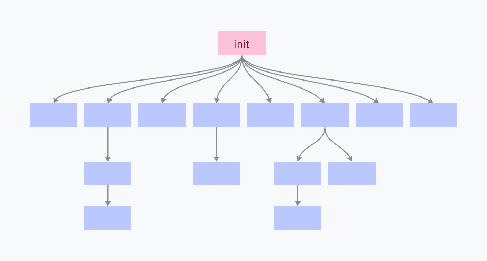

# 聊聊 Fork 与奶牛

最后一个问题：我们是怎么走到这里的？最初的进程从哪里来？

这篇文章快写完了。我们已经进入最后冲刺，马上要打出一记本垒打，奔向更绿的牧场，还有各种其他糟糕的比喻，意思都是：你只差*第 6 章这么长*的距离，就能去摸摸草，或者干点你平时不读一篇 15,000 词 CPU 架构文章时会做的事。

如果 `execve` 是通过替换当前进程来启动新程序的，那你怎样才能在一个新进程里单独启动一个新程序？如果你想在电脑上同时做多件事，这个能力相当重要；当你双击一个应用来启动它时，应用会单独打开，而你之前用的程序会继续运行。

答案是另一个系统调用：`fork`，所有多进程处理的基础。`fork` 其实非常简单——它克隆当前进程及其内存，保存的指令指针保持原位，然后让两个进程照常继续。如果没有额外干预，两个程序会各自独立运行，所有计算都会翻倍。

新运行起来的进程叫“子进程”（child），最初调用 `fork` 的进程叫“父进程”（parent）。进程可以多次调用 `fork`，从而拥有多个子进程。每个子进程都有一个*进程 ID*（process ID，PID），从 1 开始编号。

毫无头绪地把同一段代码复制一遍没什么用，所以 `fork` 在父进程和子进程中返回不同的值。在父进程中，它返回新子进程的 PID；在子进程中，它返回 0。这样一来，你就可以在新进程里做不同的工作，让 fork 真正有用。

```c
pid_t pid = fork();

// 代码从这里照常继续，但现在是在两个“完全相同”的
// 进程中分别继续。
//
// 完全相同……除了 fork 返回的 PID！
//
// 这是两个程序唯一能意识到自己并非独一无二的线索。

if (pid == 0) {
	// 我们在子进程里。
	// 做一些计算，把结果喂给父进程！
} else {
	// 我们在父进程里。
	// 大概继续做之前在做的事。
}
```

*`main.c`*

fork 一个进程这件事可能有点难理解。从现在开始，我会假设你已经搞懂了；如果还没有，可以看看[这个长得挺吓人的网站](https://www.csl.mtu.edu/cs4411.ck/www/NOTES/process/fork/create.html)，它解释得相当不错。

总之，Unix 程序启动新程序的方式，就是调用 `fork`，然后立刻在子进程中运行 `execve`。这叫作 *fork-exec 模式*。当你运行一个程序时，你的电脑会执行类似下面的代码：

```c
pid_t pid = fork();

if (pid == 0) {
	// 立刻用新程序替换子进程。
	execve(...);
}

// 既然能走到这里，说明进程没有被替换。我们在父进程里！
// 方便的是，现在我们还在 pid 变量里拿到了新子进程的 PID，
// 万一之后需要杀掉它呢。

// 父进程从这里继续……
```

*`launcher.c`*

## 哞——！

你可能注意到，复制一个进程的内存，紧接着又在加载不同程序时把它全部丢弃，听起来有点低效。幸运的是，我们有 MMU。慢的部分是在物理内存中复制数据，而不是复制页表，所以我们干脆*不*复制任何 RAM：我们为新进程创建一份旧进程页表的副本，让映射仍然指向相同的底层物理内存。

但子进程本来应该独立于父进程、与父进程隔离啊！子进程写入父进程的内存，或者反过来，都是不行的！

于是，*COW*（copy on write，写时复制）页登场了。使用 COW 页时，只要两个进程都不尝试写入内存，它们就会从相同的物理地址读取数据。一旦其中某个进程试图写入内存，那一页就会在 RAM 中被复制一份。COW 页让两个进程无需预先克隆整个内存空间，就能拥有内存隔离。这正是 fork-exec 模式高效的原因：在加载新二进制文件之前，旧进程的内存没有任何写入，所以不需要复制内存。

和许多好玩的东西一样，COW 是通过分页 hack 和硬件中断处理实现的。`fork` 克隆父进程之后，会把两个进程的所有页都标记为只读。当程序写入内存时，因为内存是只读的，写入会失败。这会触发一个段错误（硬件中断那种），由内核处理。内核复制内存，把对应页更新为允许写入，然后从中断返回，重新尝试这次写入。

> *A：咚咚咚！*  
> *B：谁呀？*  
> *A：会打岔的牛。*  
> *B：会打岔的牛什么——*  
> *A：**哞——！***

## 起初（不是《创世记》1:1）

你电脑上的每个进程，都是由某个父进程 fork-exec 出来的，只有一个例外：*init 进程*。init 进程由内核直接手动建立。它是第一个运行的用户空间程序，也是关机时最后一个被杀掉的程序。

想不想看一个很酷的瞬间黑屏？如果你用的是 macOS 或 Linux，先保存工作，打开终端，然后杀掉 init 进程（PID 1）：

```console
$ sudo kill 1
```

> *作者注：很遗憾，关于 init 进程的知识只适用于 macOS 和 Linux 这类类 Unix 系统。接下来你学到的大部分内容，并不能帮你理解 Windows，因为 Windows 的内核架构非常不同。*
>
> *就像 `execve` 那一节一样，我明确说明这一点——我完全可以再写一整篇关于 NT 内核的文章，但我正在克制自己。（暂时。）*

init 进程负责启动构成操作系统的所有程序和服务。其中许多程序和服务又会启动自己的服务和程序。



杀掉 init 进程会杀掉它的所有子进程，以及子进程的子进程，进而关闭你的操作系统环境。

## 回到内核

我们[在第 3 章](03-how-to-run-a-program.md)兴致勃勃地看过 Linux 内核代码，所以再来一次吧！这次，我们先看看内核如何启动 init 进程。

你的电脑启动过程大致如下：

1. 主板上固化着一小段软件，它会搜索你连接的磁盘，寻找一个叫*引导加载器*（bootloader）的程序。它选出一个引导加载器，把它的机器码加载到 RAM 并执行。
   
   请记住，我们还不在一个运行中的操作系统世界里。在操作系统内核启动 init 进程之前，多进程和系统调用实际上并不存在。在 init 出现之前，“执行”一个程序意味着直接跳到它在 RAM 中的机器码，不指望返回。
2. 引导加载器负责找到内核，把它加载到 RAM 并执行。有些引导加载器，比如 [GRUB](https://www.gnu.org/software/grub/)，可以配置，还可以让你在多个操作系统之间选择。BootX 和 Windows Boot Manager 分别是 macOS 和 Windows 内置的引导加载器。
3. 内核开始运行，并执行一大串初始化任务，包括设置中断处理程序、加载驱动、创建初始内存映射。最后，内核把特权级切换到用户模式，启动 init 程序。
4. 我们终于来到操作系统的用户空间了！init 程序开始运行 init 脚本、启动服务，并执行 shell/UI 之类的程序。

### 初始化 Linux

在 Linux 上，第 3 步（内核初始化）的大部分工作发生在 [init/main.c](https://github.com/torvalds/linux/blob/22b8cc3e78f5448b4c5df00303817a9137cd663f/init/main.c) 的 `start_kernel` 函数里。这个函数有 200 多行，全是在调用各种其他初始化函数，所以我不会在文章里贴出[整个函数](https://github.com/torvalds/linux/blob/22b8cc3e78f5448b4c5df00303817a9137cd663f/init/main.c#L880-L1091)，但我确实推荐你快速扫一遍！在 `start_kernel` 末尾，会调用一个名为 `arch_call_rest_init` 的函数：

```c
	/* 剩下的工作不在 __init 段中执行，因为我们现在已经活过来了 */
	arch_call_rest_init();
```

*`start_kernel @ init/main.c` 第 1087–1088 行 · [源码](https://github.com/torvalds/linux/blob/22b8cc3e78f5448b4c5df00303817a9137cd663f/init/main.c#L1087-L1088)*

> **“不在 \_\_init 段中执行”是什么意思？**
>
> `start_kernel` 函数被定义为 `asmlinkage __visible void __init __no_sanitize_address start_kernel(void)`。`__visible`、`__init`、`__no_sanitize_address` 这些奇怪的词，都是 Linux 内核里使用的 C 预处理器宏，用来给函数添加各种代码或行为。
>
> 在这里，`__init` 是一个宏，告诉内核在启动过程完成后立即把该函数及其数据从内存中释放，只是为了节省空间。
>
> 它是怎么工作的？不深入太多细节的话：Linux 内核本身也打包成一个 ELF 文件。`__init` 宏展开为 `__section(".init.text")`，这是一个编译器指令，把代码放进名为 `.init.text` 的节，而不是通常的 `.text` 节。其他宏也允许把数据和常量放进特殊的 init 节，比如 `__initdata` 会展开为 `__section(".init.data")`。

`arch_call_rest_init` 只是一个包装函数：

```c
void __init __weak arch_call_rest_init(void)
{
	rest_init();
}
```

*`init/main.c` 第 832–835 行 · [源码](https://github.com/torvalds/linux/blob/22b8cc3e78f5448b4c5df00303817a9137cd663f/init/main.c#L832-L835)*

注释里说“剩下的工作不在 \_\_init 段中执行”，是因为 `rest_init` 没有用 `__init` 宏定义。这意味着在清理 init 内存时，它不会被释放：

```c
noinline void __ref rest_init(void)
{
```

*`init/main.c` 第 689–690 行 · [源码](https://github.com/torvalds/linux/blob/22b8cc3e78f5448b4c5df00303817a9137cd663f/init/main.c#L689-L690)*

接下来，`rest_init` 为 init 进程创建一个线程：

```c
	/*
	 * 我们需要先启动 init，这样它才能获得 pid 1；但是
	 * init 任务最终会想要创建 kthreads，如果我们先调度它，
	 * 再创建 kthreadd，就会 OOPS。
	 */
	pid = user_mode_thread(kernel_init, NULL, CLONE_FS);
```

*`rest_init @ init/main.c` 第 695–700 行 · [源码](https://github.com/torvalds/linux/blob/22b8cc3e78f5448b4c5df00303817a9137cd663f/init/main.c#L695-L700)*

传给 `user_mode_thread` 的 `kernel_init` 参数是一个函数，它完成一些初始化任务，然后寻找一个有效的 init 程序来执行。这个过程从一些基础设置任务开始；大部分我会跳过，除了调用 `free_initmem` 的地方。内核就是在这里释放我们的 `.init` 节！

```c
	free_initmem();
```

*`kernel_init @ init/main.c` 第 1471 行 · [源码](https://github.com/torvalds/linux/blob/22b8cc3e78f5448b4c5df00303817a9137cd663f/init/main.c#L1471)*

现在，内核可以找到一个合适的 init 程序来运行了：

```c
	/*
	 * 我们会逐个尝试，直到有一个成功。
	 *
	 * 如果我们试图恢复一台坏得离谱的机器，
	 * 可以用 Bourne shell 代替 init。
	 */
	if (execute_command) {
		ret = run_init_process(execute_command);
		if (!ret)
			return 0;
		panic("Requested init %s failed (error %d).",
		      execute_command, ret);
	}

	if (CONFIG_DEFAULT_INIT[0] != '\0') {
		ret = run_init_process(CONFIG_DEFAULT_INIT);
		if (ret)
			pr_err("Default init %s failed (error %d)\n",
			       CONFIG_DEFAULT_INIT, ret);
		else
			return 0;
	}

	if (!try_to_run_init_process("/sbin/init") ||
	    !try_to_run_init_process("/etc/init") ||
	    !try_to_run_init_process("/bin/init") ||
	    !try_to_run_init_process("/bin/sh"))
		return 0;

	panic("No working init found.  Try passing init= option to kernel. "
	      "See Linux Documentation/admin-guide/init.rst for guidance.");
```

*`kernel_init @ init/main.c` 第 1495–1525 行 · [源码](https://github.com/torvalds/linux/blob/22b8cc3e78f5448b4c5df00303817a9137cd663f/init/main.c#L1495-L1525)*

在 Linux 上，init 程序几乎总是位于 `/sbin/init`，或者是指向它的符号链接。常见的 init 包括 [systemd](https://systemd.io/)（它的网站好得不太正常）、[OpenRC](https://wiki.gentoo.org/wiki/OpenRC/openrc-init) 和 [runit](http://smarden.org/runit/)。如果找不到别的，`kernel_init` 会默认使用 `/bin/sh`——而如果连 `/bin/sh` 都找不到，那就出了**天大的**问题。

*macOS 也有 init 程序！它叫 launchd，位于 `/sbin/launchd`。你可以试着在终端里运行它，然后就会因为“你不是内核”而被骂一顿。*

从这里开始，我们就到了启动过程的第 4 步：init 进程正在用户空间中运行，并开始用 fork-exec 模式启动各种程序。

### Fork 的内存映射

我很好奇 Linux 内核在 fork 进程时如何重新映射内存的下半部分，所以翻了翻代码。[kernel/fork.c](https://github.com/torvalds/linux/blob/22b8cc3e78f5448b4c5df00303817a9137cd663f/kernel/fork.c) 似乎包含了 fork 进程的大部分代码。文件开头很贴心地给我指了正确的方向：

```c
/*
 *  'fork.c' 包含 'fork' 系统调用的辅助例程
 * （另见 entry.S 等）。
 * Fork 一旦上手其实相当简单，但内存
 * 管理可能很要命。参见 'mm/memory.c'：'copy_page_range()'
 */
```

*`kernel/fork.c` 第 8–13 行 · [源码](https://github.com/torvalds/linux/blob/22b8cc3e78f5448b4c5df00303817a9137cd663f/kernel/fork.c#L8-L13)*

看起来，`copy_page_range` 函数接收一些内存映射信息，然后复制页表。快速浏览它调用的函数，这里也是把页设为只读、使其成为 COW 页的地方。它通过调用一个叫 `is_cow_mapping` 的函数来检查是否应该这样做。

`is_cow_mapping` 定义在 [include/linux/mm.h](https://github.com/torvalds/linux/blob/22b8cc3e78f5448b4c5df00303817a9137cd663f/include/linux/mm.h) 中；如果内存映射的[标志](http://books.gigatux.nl/mirror/kerneldevelopment/0672327201/ch14lev1sec2.html)表明该内存可写且没有在进程间共享，它就返回 true。共享内存不需要 COW，因为它本来就是为了共享而设计的。来欣赏一下这段略微难以理解的位掩码：

```c
static inline bool is_cow_mapping(vm_flags_t flags)
{
	return (flags & (VM_SHARED | VM_MAYWRITE)) == VM_MAYWRITE;
}
```

*`include/linux/mm.h` 第 1541–1544 行 · [源码](https://github.com/torvalds/linux/blob/22b8cc3e78f5448b4c5df00303817a9137cd663f/include/linux/mm.h#L1541-L1544)*

回到 [kernel/fork.c](https://github.com/torvalds/linux/blob/22b8cc3e78f5448b4c5df00303817a9137cd663f/kernel/fork.c)，简单按一下 Command-F 搜索 `copy_page_range`，会找到 `dup_mmap` 函数中的一处调用……而 `dup_mmap` 又被 `dup_mm` 调用……`dup_mm` 又被 `copy_mm` 调用……最后，`copy_mm` 又被庞大的 `copy_process` 函数调用！`copy_process` 是 fork 功能的核心，从某种意义上说，也是 Unix 系统执行程序的中心——它总是在复制并编辑一份在启动时为第一个进程创建的模板。

*（配乐：cyriak 的[《cows & cows & cows》](https://www.youtube.com/watch?v=FavUpD_IjVY)。）*

## 总结……

***那么……程序到底如何运行？***

在最底层：处理器很笨。它有一个指向内存的指针，然后一条接一条地执行指令，除非遇到一条让它跳到别处的指令。

除了跳转指令之外，硬件和软件中断也能打断执行顺序，跳到一个预设位置，再由那里选择要跳到哪里。处理器核心不能同时运行多个程序，但可以用定时器反复触发中断，让内核代码在不同的代码指针之间切换，从而模拟出这种效果。

程序被*骗*了，以为自己是一个连贯、隔离的整体。用户模式阻止了直接访问系统资源，分页隔离了内存空间，而系统调用则被设计成让程序可以进行通用 I/O，又不必了解太多真实执行上下文。系统调用是一些指令，要求 CPU 运行某些内核代码，而这些代码的位置由内核在启动时配置好。

***可是……程序究竟如何运行？***

计算机启动后，内核启动 init 进程。这是第一个运行在较高抽象层上的程序，它的机器码不必操心许多具体的系统细节。init 程序会启动那些渲染出图形环境的程序，而这些程序又负责启动其他软件。

要启动一个程序，它用 fork 系统调用克隆自己。这种克隆很高效，因为所有内存页都是 COW，不需要在物理 RAM 中复制内存。在 Linux 上，这就是 `copy_process` 函数在发挥作用。

两个进程都会检查自己是不是被 fork 出来的子进程。如果是，它们就使用 exec 系统调用，请求内核用新程序替换当前进程。

新程序很可能是一个 ELF 文件。内核解析它，找到如何加载程序、把代码和数据放到新虚拟内存映射中哪里的信息。如果程序是动态链接的，内核可能还要准备一个 ELF 解释器。

然后，内核可以加载程序的虚拟内存映射，并返回用户空间让程序运行——这实际上就是把 CPU 的指令指针设置为新程序代码在虚拟内存中的起始位置。

---

上一章：[第 5 章：你电脑里的翻译官](05-the-translator-in-your-computer.md) · 下一章：[第 7 章：尾声](07-epilogue.md)
